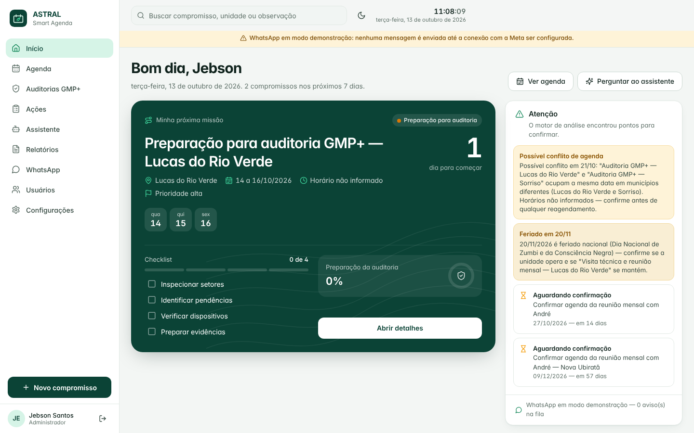
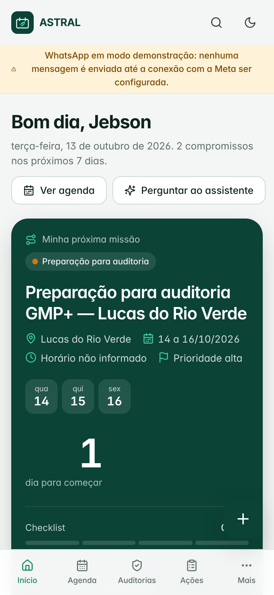

# ASTRAL Smart Agenda

Agenda operacional da **Astral Saúde Ambiental** para o Supervisor Técnico e o Coordenador de Operações: auditorias GMP+, visitas técnicas, reuniões, checklists, ações e deslocamentos entre unidades — com alertas automáticos e notificações pela **Cloud API oficial do WhatsApp**.

| Computador | Celular |
|---|---|
|  |  |

## O que o sistema faz

- **Painel executivo** com "Minha próxima missão", relógio em tempo real, hoje e próximos 7 dias, auditorias em preparação, reuniões a confirmar, visitas, concluídas e atrasadas, execução do mês, linha do tempo, gráfico e alertas.
- **Agenda inteligente** em cinco visões (mês, semana, dia, lista, linha do tempo), filtros, pesquisa, recorrência e **arrastar para reagendar** (sempre com confirmação). Horário é opcional e nunca presumido.
- **Compromissos completos:** cliente, unidade, município, categoria, responsável, participantes e presença, prioridade, status, checklist por etapa, observações, anexos e fotos, histórico de alterações e configuração de avisos.
- **Motor de análise:** possíveis conflitos (por data) e conflitos confirmados (por horário), deslocamento entre municípios, feriados, preparação insuficiente de auditorias, confirmações pendentes, atividades vencidas, dias livres sugeridos, prioridades e resumos executivos. Nunca altera nada sozinho.
- **Auditorias GMP+** por etapa (pré, durante e pós), com % de preparação, pendências críticas, prazo restante e apontamentos com responsáveis e prazos. Modelos de checklist editáveis.
- **Visitas técnicas e reuniões mensais** com objetivo, atividades, pendências, encaminhamentos, resultado, pauta, ata, decisões e tarefas derivadas; painel de ações.
- **WhatsApp oficial (Meta Cloud API):** remetente, destinatários com consentimento, preferências individuais, 8 tipos de aviso, templates, envio de teste, fila persistente sem duplicidade, retentativas seguras, logs e webhooks assinados. **Modo demonstração claramente identificado** enquanto a Meta não estiver configurada.
- **Assistente** que responde perguntas sobre a agenda usando só os dados cadastrados.
- **Relatórios:** agenda mensal (PDF), resumo executivo, Excel, ICS, relatório de auditoria e de visitas/reuniões.
- **Usuários e permissões:** administrador/supervisor e coordenador prontos, permissões extras configuráveis, perfis para expansão e trilha de auditoria.
- **PWA instalável** no Android e iPhone, modo escuro, responsivo.

Os **10 compromissos reais de 2026** já vêm cadastrados, incluindo o alerta de possível conflito em 21/10 entre as auditorias de Lucas do Rio Verde e Sorriso.

## Rodar

Requisito: **Node.js 22.18+**. O pacote já inclui o sistema compilado em `dist/` — não precisa instalar nada.

```bash
cp .env.example .env      # ajuste APP_URL, senhas iniciais e segredos
node --disable-warning=ExperimentalWarning dist/server.mjs
# abra http://localhost:3000
```

Na primeira inicialização são criadas as contas do Supervisor Técnico (login `supervisao.snp@grupoastral.com.br`) e do Coordenador (senhas de `SUPERVISOR_INITIAL_PASSWORD` / `COORDINATOR_INITIAL_PASSWORD`, ou geradas em `data/credenciais-iniciais.txt`). A troca de senha é obrigatória no primeiro acesso. Se não conseguir entrar, redefina a senha pelo terminal: `node --disable-warning=ExperimentalWarning dist/server.mjs --redefinir-senha <e-mail> <nova-senha>` (detalhes em [docs/IMPLANTACAO.md](docs/IMPLANTACAO.md)).

Para colocar no ar com HTTPS: veja **[docs/IMPLANTACAO.md](docs/IMPLANTACAO.md)** (Docker + Caddy em uma VPS é o caminho recomendado).

## Desenvolvimento

```bash
npm install          # dependências de desenvolvimento (build e testes)
npm run build        # compila app + servidor em dist/
npm run dev          # recompila e reinicia a cada alteração
npm test             # 67 testes de regras de negócio e APIs
npm run typecheck    # verificação de tipos do servidor e dos testes
npm run e2e          # fluxos pela interface no Chromium (requer Playwright)
npm run screenshots  # capturas em celular, tablet e computador
npm run backup -- ./copia.db
```

## Documentação

- [docs/IMPLANTACAO.md](docs/IMPLANTACAO.md) — hospedagem, HTTPS, variáveis, backups, atualização
- [docs/WHATSAPP.md](docs/WHATSAPP.md) — conexão com a Meta passo a passo e texto dos 9 templates
- [docs/ARQUITETURA.md](docs/ARQUITETURA.md) — componentes, dados, permissões, fila de avisos, migração para PostgreSQL, integração com o ERP e IA
- [docs/MANUAL.md](docs/MANUAL.md) — como usar cada tela
- [docs/CRITERIOS.md](docs/CRITERIOS.md) — os 14 critérios de conclusão e onde verificar cada um

## Pilha

Node.js 22 (servidor HTTP próprio, SQLite embutido `node:sqlite`), React 19 + TypeScript, Tailwind CSS v4, ícones Lucide, fonte Inter, pdf-lib, zod, esbuild. **Sem dependências em produção.** A arquitetura recomendada na especificação (Next.js + Supabase/PostgreSQL) não pôde ser instalada no ambiente de construção, que não tinha acesso ao npm; a escolha, as vantagens e o caminho de migração para PostgreSQL estão em [docs/ARQUITETURA.md](docs/ARQUITETURA.md).
